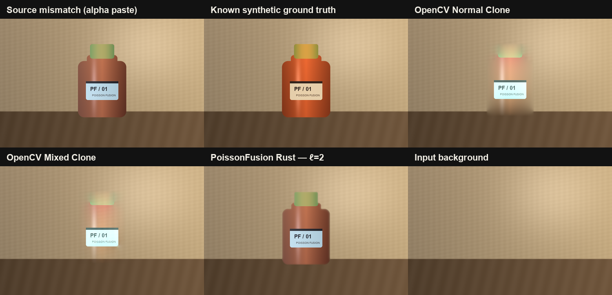

# PoissonFusion (Rust)

PoissonFusion is a deterministic, identity-preserving alternative to classic
Poisson cloning. It solves only for the smooth colour/illumination correction
needed at the cutout boundary; source texture, logos, and small details pass
through unchanged.

The core has one meaningful artistic parameter: the integration length `ℓ`.

- small `ℓ`: the correction dies near the seam, preserving the source;
- large `ℓ`: the correction reaches the interior and approaches classic
  Poisson behaviour.

The method is implemented as a reusable Rust crate and CLI under the MIT
license. It is an experimental research prototype, not a claim of universal
state-of-the-art performance.



The full derivation, prior-art review, well-posedness argument, and controlled
comparison are available in the [technical white paper](PoissonFusion_whitepaper.pdf)
and its [Markdown source](paper/PoissonFusion_whitepaper.md).

## The formula

Let `S` be the linear-light source, `T` the destination, `Ω` the pasted region,
and `δσ` their low-frequency mismatch along the cutout boundary. PoissonFusion
solves only the correction field `c`:

```text
c* = argmin_c  1/2 ∫Ω |∇c|² + 1/(2ℓ²) ∫Ω |c|²
     subject to c|∂Ω = δσ

δσ = Gaussianσ(T) - Gaussianσ(mask · S) / Gaussianσ(mask)
```

The Euler equation is:

```text
(-Δ + 1/ℓ²)c = 0  in Ω,     c = δσ on ∂Ω.
```

The composite is formed in linear light:

```text
C = (1 - alpha) T + alpha (S + c*).
```

For positive `ℓ`, the discrete energy is strictly convex and its matrix is
symmetric positive definite. The solution is unique and is computed with a
matrix-free, Jacobi-preconditioned conjugate-gradient solver.

## Build and test

```bash
cargo test
cargo build --release
```

Tested with Rust 1.97.1 on macOS arm64. The crate uses safe Rust.

## CLI

```bash
./target/release/poissonfusion \
  --background background.jpg \
  --foreground cutout.png \
  --x 420 --y 180 \
  --preset faithful \
  --output composite.png \
  --diagnostics diagnostics.json
```

`foreground` must be RGBA. Coordinates specify its top-left corner.

Presets:

- `faithful`: `ℓ = 2 px`;
- `balanced`: `ℓ = 6 px`;
- `seamless`: `ℓ = 18 px`.

Override the model directly with `--integration-length` and
`--appearance-sigma`. `--repeat 3` reports a median in-memory runtime without
including image decoding or encoding.

## Library API

```rust
use image::{RgbImage, RgbaImage};
use poissonfusion::{blend, BlendConfig};

fn composite(
    background: &RgbImage,
    foreground: &RgbaImage,
) -> Result<RgbImage, poissonfusion::BlendError> {
    let result = blend(
        background,
        foreground,
        (420, 180),
        BlendConfig::faithful(),
    )?;
    Ok(result.image)
}
```

`BlendResult.stats` exposes the ROI, domain size, unknown count, PCG iterations,
relative residuals, and screening coefficient.

## Reproduce the controlled comparison

The optional comparison harness requires Python, NumPy, SciPy, Pillow, and
OpenCV only to generate the synthetic inputs and baseline images. PoissonFusion
itself is always executed through the release Rust binary.

```bash
python3 benchmarks/make_demo.py
```

The case is a transparent regression fixture with a known synthetic target. It
is not a general benchmark. The generated report is in
`benchmarks/results.json`, and the visual comparison is in
`examples/comparison.png`.

## Scope and limitations

PoissonFusion controls low-frequency boundary adaptation. It does not repair a
bad matte, infer geometry, perform physical relighting, or invent contact
shadows and reflections. Those should remain separate stages in a production
object-insertion pipeline.

The current separable Gaussian and PCG implementation is CPU-only. A production
port should use SIMD/parallel filtering and multigrid, FFT, Metal, CUDA, or
WebGPU acceleration for large images and video.

## License

MIT. See [LICENSE](LICENSE).
